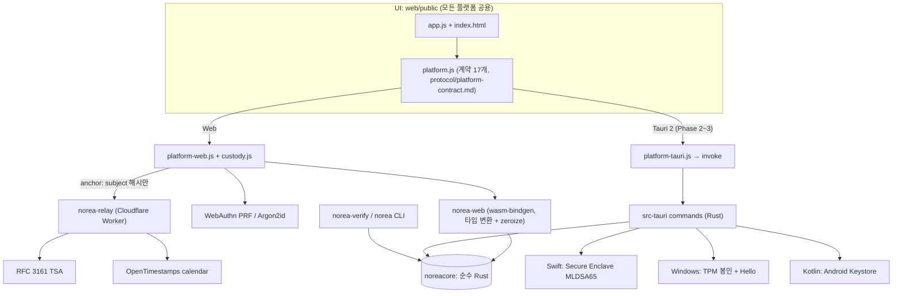

# NoREA Architecture

현재 상태 기준(STATE 문서, 현재 시제). 포맷의 바이트 단위 정의는 `docs/protocol/`이 규범이고 이 문서는 그것을 인용만 한다.

## 1. 한 장 요약



core는 하나다. 플랫폼마다 새로 쓰는 것은 키 보관 adapter와 바인딩뿐이다.

## 2. 계층과 책임

| 계층 | 위치 | 하는 일 | 하지 않는 일 |
|---|---|---|---|
| core | `core/` (`noreacore`) | 파싱(JSON/CSV), shape 추론, canary 생성·삽입, evidence prepare/finalize/verify, Merkle, blob 암복호, check, disclose, disclosure verify, RFC 3161 req/resp encode/parse | RNG, 네트워크, 파일 I/O, 키 저장, 시계 |
| bindings | `web/src` (wasm-bindgen), `src-tauri` (Phase 2) | 타입 변환, 비밀 zeroize | 로직 |
| CLI | `cli/` (`norea-verify`, `norea`) | 파일 I/O, 인자 파싱, 사람용 출력 | 로직 |
| platform adapter | `custody.js`, `platform-*.js`, relay, Swift/Kotlin 플러그인 | 키 생성·보관, 사용자 인증, 파일 저장, anchor 네트워크 | canary/evidence 로직 |
| UI | `app.js`, `index.html` | 입력, 결과 표시, 안내 문구 | 암호 연산, 비밀 접근 |

## 3. 데이터 파이프라인

### 3.1 Setup
```
[platform] K(32B) + seed(32B) = CSPRNG 64B
[platform] KEK = HKDF(PRF 출력) 또는 HKDF(Argon2id(passphrase))        protocol/custody-web-v1.md
[platform] blob = AES-256-GCM(KEK, K||seed), IndexedDB 저장, persist() 요청
[UI]       암호화 백업 다운로드 강제. prf 방식이면 passphrase 2차 백업 권장
[core]     vk = ML-DSA-65 공개키(seed) → 지문 표시
```
macOS/iOS 26+: K만 위처럼 만들고 서명키는 Secure Enclave 안에서 생성(시드 없음).

### 3.2 Inspect (비밀 없음)
입력 파일을 파싱해 필드, kind, 추천 marker, 행 수, 경고를 보여준다. 운영자가 marker를 바꾸거나 exclusions 파일을 붙인 뒤 Protect로 간다.

### 3.3 Protect
```mermaid
sequenceDiagram
  participant U as UI
  participant P as platform
  participant W as norea-web
  participant C as noreacore
  U->>P: protect({input, datasetId, n, markerFields?, exclusions?})
  P->>P: 사용자 인증 → K, seed 언랩
  P->>W: protect(input, K, seed, datasetId, optionsJson, nowClaim)   (비밀 1회 통과)
  W->>C: K_d = HKDF(K, datasetId); table = parse; shape = infer
  W->>C: canaries + marked = generate_and_insert(K_d, ...)
  W->>C: ev = prepare_evidence(...) ; sig = SoftwareSigner(seed).sign(payload) ; finalize
  C-->>W: marked bytes, evidence JSON
  W->>W: zeroize(K, seed, K_d, K_blob)
  W-->>P: {marked, evidenceJson}
  P->>P: JS 버퍼 fill(0)
  P-->>U: marked(공개용), evidence.json(비공개)
  U->>P: anchor({evidenceJson})  (선택, 네트워크)
  P->>P: subject = SHA-256(payload||\n||sig) → relay → anchors[] 추가
```
Secure Enclave 플랫폼은 `prepare_evidence` → 네이티브 서명 → `finalize_evidence`.

### 3.4 Check (운영자, K 필요)
```
입력: 의심 사본(JSON/CSV/HTML/텍스트) + evidence.json
[core] K_d → K_blob → blob 복호화 → canary rows → Merkle root 재계산 == canary_root (commit_ok)
[core] 레코드 추출 → marker k-of-n 대조 (protocol/canary-record-shape-v1.md §7)
[core] evidence 검증(서명, id, blob 해시, anchor imprint)
출력: norea.check-report.v1
```

### 3.5 Disclose (운영자, K 필요) → Verify (누구나)
```
[core] disclose: 일치한 canary의 row + Merkle path + evidence + 사본 해시 → norea.disclosure.v1
[core] verify_disclosure(비밀 없음): 서명, id, blob 해시, anchor imprint, Merkle path, 사본에서 일치 재현 → statement
[CLI]  norea-verify disclosure.json suspect.bin [--export-anchors DIR]
```

### 3.6 Renew (Phase 4)
RFC 4998 방식. 서명이나 anchor 알고리즘이 약해지기 전에 기존 evidence의 anchor_subject를 새 anchor로 다시 고정한다. `anchors[]`에 추가.

### 3.7 Monitor (Phase 4, 선택)
운영자가 등록한 URL watchlist만. robots.txt와 rate limit 준수. 서버에는 해당 데이터셋의 K_d와 evidence만. K, seed는 절대 서버에 가지 않는다. K_d가 유출돼도 그 데이터셋의 canary만 드러나고 증거 위조는 불가능하다(서명키가 없으므로).

## 4. 신뢰 경계: 무엇이 기기를 떠나는가

| 데이터 | 기기 밖으로 | 비고 |
|---|---|---|
| 원본 데이터셋 | 아니오 | |
| marked 파일 | 운영자가 직접 공개 | 공개가 목적. canary 포함 |
| evidence.json | 아니오. 분쟁 때 disclosure로 가공 | canary는 암호화 blob + Merkle root로만 |
| disclosure.json | 운영자가 제출 | 공개하기로 한 canary row만 평문 |
| K, seed / SE 키 | 절대 아니오 | 암호화 백업만 |
| K_d | Phase 4 Monitor를 켰을 때만 | 해당 데이터셋 한정 |
| anchor_subject (32 B) | anchor 때 relay/TSA/OTS로 | 해시만 |
| exclusions(registry) | 아니오 | 로컬 대조 |
| passphrase | 아니오 | JS string, 0으로 못 덮음(ADR-0006) |

## 5. 포맷 (규범은 protocol/)

| 포맷 | 문서 | 식별자 |
|---|---|---|
| Evidence | protocol/evidence-v1.md | `norea.evidence.v1`, SIG_CTX `norea/evidence/v1` |
| Canary generator | protocol/canary-record-shape-v1.md | `record.shape.v1` |
| Check report | canary-record-shape-v1.md §7.5 | `norea.check-report.v1` |
| Disclosure | protocol/disclosure-v1.md | `norea.disclosure.v1`, `norea.disclosure-report.v1` |
| Custody backup | protocol/custody-web-v1.md | `norea.custody-backup.v1` |
| Platform contract | protocol/platform-contract.md | `CONTRACT` 17개 |

## 6. 플랫폼 매트릭스

| 플랫폼 | UI | 바인딩 | 서명 | 키 보관 | 새로 쓸 코드 | core 변경 |
|---|---|---|---|---|---|---|
| Web | `web/public` | wasm-bindgen | WASM SoftwareSigner | PRF / Argon2id | Phase 1 | 0 |
| CLI (macOS/Linux/Windows) | 없음 | 없음 | 검증만(비밀 없음) | 없음 | `cli/` | 0 |
| macOS 26+ | 같음 | Tauri | SE MLDSA65 + seam | SE | `platform-tauri.js`, `src-tauri`, Swift plugin | 0 |
| Windows 11 | 같음 | Tauri | native SoftwareSigner | TPM 봉인 + Hello | Windows custody(Rust) | 0 |
| iOS 26+ | 같음 | Tauri mobile | SE + seam | SE | Swift plugin 공유 | 0 |
| Android | 같음 | Tauri mobile | native SoftwareSigner | Keystore + Biometric | Kotlin plugin | 0 |

## 7. 성능 예산 (목표. 실측은 WP가 채운다)

| 항목 | 목표 | ProvGuard 실측 참고 |
|---|---|---|
| 5만 행 3.6 MB JSON: inspect | < 500 ms (WASM) | 해당 없음 |
| 5만 행: protect (canary 64, 서명 포함) | < 1.5 s (WASM) | 243~333 ms (단순 생성기) |
| 5만 행: check | < 1 s | 위에 포함 |
| ML-DSA-65 sign / verify (WASM) | 참고 | 3.0 / 0.66 ms |
| Argon2id 64 MiB t=3 (WASM) | < 1 s 데스크톱, < 3 s 모바일 | 213~248 ms (서버 CPU) |
| 브라우저 wasm 크기 (wasm-opt 후) | Phase 1 ≤ 800 KB (원래 목표 600 KB. WP-10에서 기여도 분석 후 줄이거나 목표를 확정) | 782 KB (WP-06 실측, `-O3`. opt-level z + `-Oz`면 607 KB. 구성: code 647 KB, data 185 KB) |

## 8. 알려진 한계 (정직하게)

1. 데이터를 통째로 바꾼 클론은 canary로 못 잡는다.
2. 생성기는 필드 간 상관을 모른다. 상관 강한 데이터에서 통계 검정에 걸릴 수 있다.
3. canary가 실제 세계에 없다는 보장은 exclusions를 넘길 때만 완전하다.
4. Web, Windows, Android는 서명 순간 키가 메모리에 있다.
5. anchor 전까지 "언제"를 증명하지 못한다. TSA 체인 검증은 수동이다.
6. 사본 포착 시점은 이 제품이 증명하지 않는다(외부 증거 필요).
7. WebAuthn PRF와 DOM은 진짜 브라우저 테스트(WP-09) 전까지 미검증이다.
